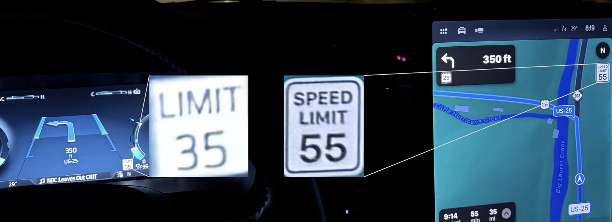
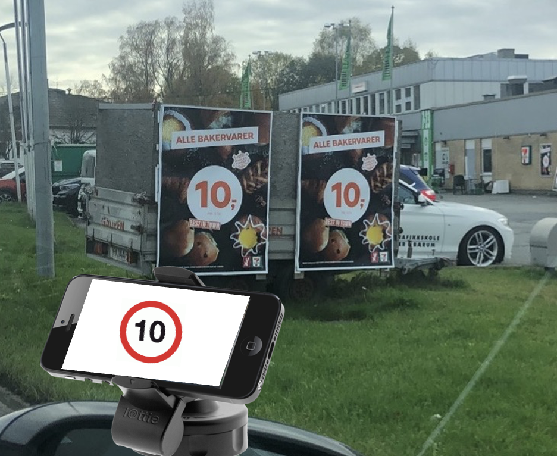

# The Challenge

The modern driving experience is rapidly evolving. The use of navigation systems is extremely widespread and the adoption of Level 1-3 Automated Driving Systems (ADS) continues to expand. However, there are challenges in moving into Level 4 and 5 ADS. For the most part, current systems still rely upon a human driver in the loop due to challenges in consistently and accurately recognizing and following rules and regulations (R&amp;Rs).

Most users are familiar with the problems. Systems leveraging databases face challenges in maintaining up-to-date information. As a result, many users of these systems have experienced their systems reporting an erroneous speed limit.

<figure><figcaption>Example of database error</figcaption></figure>

Video image processing systems also have challenges. Not only can signs be obscured, but signs can sometimes be misinterpreted.

<figure><figcaption>Example of video image processing error</figcaption></figure>

## Limitations of the Status Quo

These errors can lead to drivers unintentionally violating the intended R&amp;Rs; however, at present, the driver is still responsible for catching these inaccuracies and ensuring that the vehicle is operated in a safe and compliant manner. Migrating to Level 4 and Level 5 ADS requires a process that prevents these errors from happening. While there are some Level 4 Automated Driving Systems in operation, they have operational design domains (ODDs) that are limited to areas where the operating entities ensure that all R&amp;Rs are properly understood. This type of solution can work for prototype and early deployments, but is not scalable for large-scale use. To achieve large scale deployments, the industry needs a way to provide R&amp;Rs to vehicles in a trustworthy, electronic manner.

If these errors persist, users will lose trust in driving automation and information systems and deployment of life-saving technologies will be delayed.

