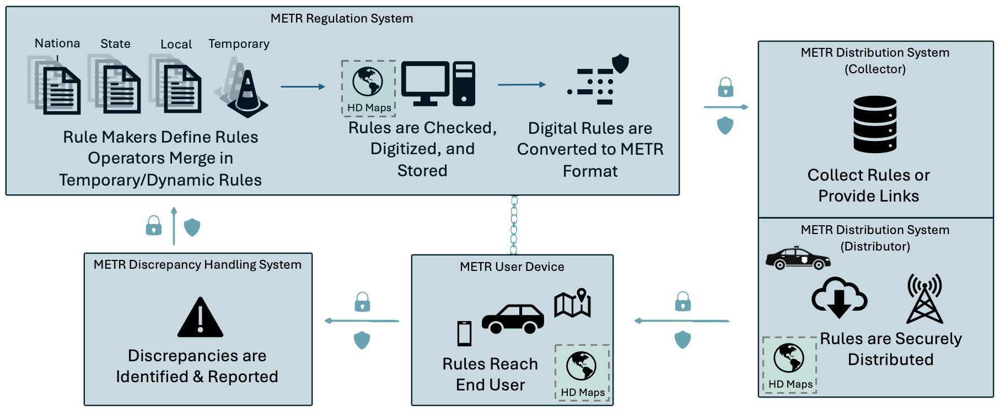

# Guidance for METR Distribution System

!!! note
    ==Audience: Deployer of METR distribution system (e.g., OEMs, navigation systems, NAPs)==

    ==Purpose: Guidance for implementation, deployment, maintenance, and operation, including legal and cybersecurity responsibilities==

    ==Scope: Guidance on:==

    ==- Prerequisites and policies that need to be established/considered==

    ==- Account management & relationships that may need to be created==

    ==- Resources & capabilities needed==
    
    ==- Data quality & consistency, certification, certificate management==

    ==- Responsibilities of owner/operator (including any legal responsibilities)==
    
    ==- Sample project-level architecture, existing systems with similar or related capabilities==

## ==Introduction==

### ==Purpose of Page==

==This page is intended to provide comprehensive guidance for deploying and managing a Management of Electronic Traffic Regulations (METR) distribution system. It focuses on the critical aspects that must be considered by entities responsible for distributing METR data, including prerequisites for deployment, maintenance requirements, interoperability standards, and optional features. This guide aims to equip stakeholders with the knowledge needed to establish and operate a robust and efficient distribution system that meets the needs of diverse user groups and ensures the reliable dissemination of rules and regulations.==

### ==Audience==

==This page is designed for a broad audience, including system administrators, IT professionals, transportation planners, and regulatory authorities involved in the deployment and management of METR distribution systems. It is also valuable for consultants and service providers who support these entities, as well as policymakers who oversee transportation regulations and ensure that these systems meet legal and operational standards.==

## Position within the reference architecture

The distribution system is the delivery system. It receives the electronic regulations from the regulation system(s) and delivers them to the METR user systems.

<figure><figcaption>The METR distribution system between regulation systems and users</figcaption></figure>

## Prerequisites

Deploying a METR distribution system requires meeting several prerequisites to ensure successful implementation. These include all of the prerequisites identified for the **[system management perspective](system-management-perspective.md)**, and the following:

1. Identify the geographic area(s) that the distribution system will serve.
1. Identify whether the distribution system will support pre-announced regulations, emergent regulations, or both.
1. Identify the types of electronic regulations that will be supported.
1. Identify the types of vehicles that will be supported.
1. Identify the interoperability standards that will be required.
1. Identify the certification and certificate management requirements as established by the **[regional body](regional-body-perspective.md)**.
1. Become aware of the legal responsibilities of the owner/operator as established by the **[regional body](regional-body-perspective.md)**.
1. Identify the regulation system(s) that the distribution system will need to connect to.
1. Establish agreements with the regulation system(s) to obtain the necessary data.
1. Identify the consumers of the data, specifically, will the distribution system act as a collector for other distribution systems, provide data directly to consumer systems, or both?
1. Establish agreements with the consumers of the data to ensure that the data is used in accordance with the applicable restrictions.
1. Define the deployment architecture.
1. Implement the distribution system in accordance with the **[regional body policies and guidelines](regional-body-perspective.md)**.

## What Are the Minimal Requirements for Interoperability?

Interoperability is a key factor in the success of a METR distribution system. To do its job, the METR distribution system must be able to obtain the electronic regulations from the regulation system(s) (typically multiple regulation systems) and distribute them to typically a large number of user devices. The regional body should adopt standards for these interfaces to simplify integration, but if not, the distribution system will still need to coordinate with these other systems to ensure that the distribution system can perform its job.

### Who Is the Target Market for the Distribution System?

The reference architecture splits that work into two roles, which may be filled by the same distribution system or two different distribution systems in series:

- The **collector** role obtains regulations from the regulation systems that hold them, often across a wide area such as a country. The system may also act in the distributor role, can send data to one or more other distribution systems, or both.
- The **distributor** role delivers regulations to consumer systems on-board vehicles. This can be a government-based distribution system or a commercial provider, such as navigation services, vehicle manufacturers, fleet systems, and similar providers.

The [regional body](regional-body-perspective.md) should provide guidance on preferred models for collectors and distributors in a region. The [key functions](key-functions.md) page describes how these systems sit in the reference architecture.

### Collection from rule makers

The collector role is intended to reach across multiple regulation systems and consolidate R&amp;Rs into a single data store to facilitate access for the distributor role.

Rather than establishing a separate distribution system acting as a collector of multiple regulation systems, a region may establish a service discovery service such that distribution systems can discover and connect to all of the registered regulation systems within a geographic area. The region should establish guidelines on how this should work within its region.

A collector needs to clearly indicate the following, so that other systems are not left to guess:

- the geographic area served
- whether the feed includes [pre-announced regulations](deployment-scenarios.md#pre-announced-regulations), [emergent regulations](deployment-scenarios.md#emergent-regulations), or both
- which regulation categories and vehicle types are included
- which regulation systems are connected, and under what agreement

Pre-announced R&amp;Rs, such as most rules issued by a legislature or regulations issued by a road authority, are known before they take effect and can be collected on a planned cycle. An emergent regulation, such as a closure issued by a road operator or an emergency responder, ha to be collected quickly enough that a user already on the road and in the vicinity of the regulation can receive it.

### Regional Guidance

The reference architecture for the regional body will likely provide guidance on the target market for a METR distribution system within the region. For example, the region can provide provide guidance that distribution systems are assumed to be private third parties, such as navigation systems and OEMs. In this case, the interface between the distribution system and the user device is more likely to be proprietary. Whereas if the regional guidance is that government agencies should provide the regulations directly to METR users, the interface will need to be fully standardized to ensure that it is readily accessible.

The needs of each user group can vary. For example, in-vehicle navigation systems may require real-time access to regulation updates and emergent regulations, while pre-trip planning services are primarily concerned about pre-announced regulations. Understanding the needs of these different user groups is essential for designing a system that meets their expectations and supports their operations.

### Regulation Packaging

In most cases, the distribution system will need to be able to repackage the electronic regulations provided by the regulation system(s) into a structure that is more appropriate for the user device.

The regulation system will likely package and sign the regulations into a electronic **[traffic regulation order](tro-what-is-a-tro.md)**, which is an electronic representation of the legal document that establishes one ore more traffic regulations. However, TROs group regulations from a traffic operations perspective rather than a user need-to-know perspective. For example, a single TRO for a road works project can contain regulations for lane shifts (including the positioning of traffic cones), speed limits, parking restrictions, and other regulations for both directions on multiple roads over multiple phases of a project. By comparison, a user device may only need to know about the speed limit and lane shift regulations for a specific direction on a specific road at a specific time. Distributing the entire TRO is not necessary, wasteful of bandwidth, processing, and memory resources, and can delay the delivery of other (e.g., emergent) regulations to the user device that could be safety relevant.

#### Packaging of regulations for consumption

A [traffic regulation order](tro-what-is-a-tro.md) groups regulations the way a rule maker adopts them. One order for a road-works project may contain lane shifts, speed limits, and parking restrictions, in both directions, on several roads, across several phases. A vehicle approaching one of those roads needs the speed limit and the lane shift for its direction at that time. Sending the entire order spends bandwidth, processing, and memory on regulations that user will not apply, and it can delay an emergent regulation that does matter.

Packaging is the repackaging of signed regulations into a set shaped by what the consumer asked for: a place or a route, a direction, a time, a vehicle class, and the regulation categories that consumer uses. During the repackaging process, it is critical that the trust chain is maintained so that there is always a clear chain of trust back to the original rule maker. Packaging changes how regulations are grouped for delivery. It does not create a new legal instrument.

Whatever is packaged, the consumer has to be able to tell what the package claims to contain. For each area, the distributor should indicate which regulation categories are electronically available, whether that electronic set is complete for those categories, and whether the electronic regulation is legally binding or informational. Without that, a user could incorrectly trust an incomplete feed, or ignore a feed that is complete for the categories it claims.

#### Types of Vehicles

A distribution system can choose to support different types of vehicles, including passenger cars, commercial trucks, public transit vehicles, autonomous vehicles, micromobility vehicles, public-area mobile robots (PMRs), etc. Each vehicle type may require different regulation sets and the system must be able to deliver the appropriate information to each user group supported. For example, autonomous vehicles may need highly detailed and precise regulation data to ensure safe and compliant operation, while traditional vehicles may require simpler, more general information.

## Synthesis and conflict screening

Collection produces a new set of R&amp;Rs that have not necessarily been compiled into a single source before. The collector role has the responsibility of consolidating these R&amp;Rs into a single data store and performing checks to identify any potential conflicts or discrepancies.

The goal of screening is to identify any inconsistencies in the consolidated set of R&amp;Rs before the set is offered to users. Some checks can be flagged as known problems. A regulation should carry a valid signature from an authorized issuer, and it should fall inside the jurisdictional boundary and the scope that issuer was given. A regulation that fails those checks can be kept out of the distributed set and sent back to its source.

Other conflicts are more challenging. Two different jurisdictional entities (e.g. a local government and its parent) can issue regulations that create a conflict. For example, a local government could, in theory, issue a regulation that sets a speed limit in excess of teh national speed limit. METR does not attempt to automatically resolve such conflicts, rather, it is designed to report the facts, as entered, and identify any detected conflicts such that human operators are able to investigate and correct records as appropriate. If the political entities assert that there is a conflict, METR allows the conflict to be transmitted and it is up to the legal environment to determine the precedence of the regulations. Where the disagreement is intentional, METR allows flags to be set to suppress future conflict reporting.

That report is a system-generated discrepancy, distinct from a report filed later by someone on the road. The [functional view](functional-view.md#report-system-generated-discrepancies) describes the first kind. The [discrepancy handling](discrepancy-handling-perspective.md) guidance describes how reports are handled after they leave the distributor.

### How Long Do the Received Regulations Remain Reliable Once They Are Received from the Regulation System?

The reliability of received regulations is determined by several factors, including the frequency of updates and the nature of the regulations themselves. Generally, regulations remain reliable as long as they reflect current regulations and have not been superseded by new updates or emergent regulations. Operators must establish clear policies for how long received regulations are considered fresh and implement mechanisms to ensure that users receive the most up-to-date information. This may involve setting specific freshness periods for different types of regulations and ensuring that regulations are refreshed regularly.

### How Often Should Regulations Be Refreshed for the User?

The frequency of regulation refreshes depends on the type of regulation and the needs of the user. For example, static regulations, such as speed limits, may require less frequent updates, while dynamic regulations, such as lane closures or temporary restrictions, may need to be refreshed more frequently to ensure accuracy. Operators should establish guidelines for how often different types of regulations should be refreshed and implement systems that automatically update users with the latest information based on these guidelines.

### What Is the Difference Between Pre-Announced and Emergent Regulations and How Does This Affect a Distribution System?

Pre-announced regulations are planned and communicated well in advance of their implementation, allowing for more straightforward processing and distribution. Emergent regulations, on the other hand, are created in response to immediate needs or unforeseen circumstances and must be distributed quickly to be effective. The METR deployment needs to identify which types of regulations are supported and how distribution of the different types of regulations is to be managed.

## How to Tailor the Guide and the Standards

While this guide provides a comprehensive framework for deploying a METR distribution system, it is important for regional bodies and operators to tailor the guidance and standards to their specific needs and contexts.
