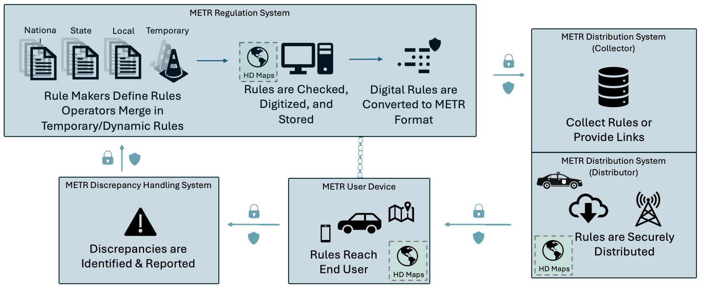

# Key components of the METR system of systems

The key components of the system are depicted in the following figure and explained further below.

<figure><figcaption>Conceptual Architecture</figcaption></figure>

The reference architecture of the METR [system of systems](system-of-systems.md) consists of four major component systems that support external users and systems, as follows:

1. Regulation system: Regulators enter rules and regulations (R&Rs) into a regulation system. The R&Rs can include any rule or regulation — mandatory, advisory, or guidance — such as speed limits, advisory speeds, stop signs, warnings, parking restrictions, etc. While each regulator could have its own regulation system, it is envisioned that smaller regulators would enter their regulations into the regulation system of a large (e.g., metropolitan) area. For example, a small store might need to register that it maintains a single regulation (e.g., a specific parking space in their parking lot is legally reserved for persons with disabilities). Rather than establishing their own regulation system to store this one regulation, the store owner can follow the procedures established by the local regulation system to enter their information into the METR network. In fact, it is expected that the challenges of implementing and maintaining a regulation system will encourage even moderately sized cities to enter their regulations into the regulation system of a larger area. Regardless, the end result is a trusted and verifiable source that maintains R&Rs that are digitally-signed to capture the legal entity that issued the R&R. The [regulation system implementation guide](regulation-system-perspective.md) provides additional details on the regulation system and how it is used.

2. Distribution system: The METR reference architecture separates the distribution system from the regulation system to allow for different deployment scenarios. For example, while it is envisioned that there will be distinct regulation systems for each localized area (e.g., metropolitan area), it is envisioned that distribution systems are likely to cover much larger areas (e.g., national or multi-national). This allows the METR consumer system to collect all regulations for its journey even if it crosses the boundaries of localized regulation systems. Different distribution systems might also exist for different types of users. For example, road vehicles and public-area mobile robots (PMRs) will typically operate in different environments and have different R&Rs. The R&Rs might be issued by the same regulators. While all of these regulations could be hosted by the same distribution system, the METR standards allow for distribution systems that are tailored to the specific needs of its user community. In addition, the distribution system can be layered. For example, a national access point (distribution system) can be established to collect all regulations from regulation systems within a nation and distribute these regulations to other distribution systems (e.g., navigation systems, OEMs) for eventual distribution to end users. It is the responsibility of the [regional implementation guide](regional-body-perspective.md) to define how this works within the chosen region so that any user can have confidence that they are collecting all regulations that they must follow.

3. Consumer system: The METR consumer system interacts with METR distribution systems to obtain the regulations that it currently needs (e.g., for its current trip). Due to the constraints imposed by the communications and memory storage environment of the consumer system, the reference architecture focuses on providing the consumer system with the regulations that are currently needed. While it is desirable to have perfect communications with the centralized distribution system; the METR reference architecture is designed to support resiliency and assumes that communication failures and poor coverage will still occur. As such, when new regulations emerge, the regional METR architecture should identify alternate communication paths that can be used to inform METR users (e.g., notification from a local beacon in large areas with poor cellular coverage). The METR consumer system is responsible for relaying all known and current METR regulations to the METR user system (e.g., ADS or driver information system). Interpretation and presentation of these regulations is left to the METR user system. For example, the METR consumer system is responsible for maintaining awareness of current parking restrictions; it is not responsible for comparing the applicable times for the parking restriction to the current time. That is left to the METR user system. For example, METR is responsible for informing the host system that parking restrictions are in affect from 08:00 to 12:00 local time. It is the responsibility of the METR user system and the METR user to realize that it is not wise to park in the space at 07:55, if the user plans to stay there for more than 5 minutes. By comparison a navigation system might use that same METR regulation to assist a user to plan a trip for tomorrow. It is the navigation system's responsibility to be aware of the time that the user is planning for and to determine which regulations will apply for that time.

4. Discrepancy handling system: One aspect of the METR consumer system is also responsible for reporting any inconsistencies discovered, whether detected by the consumer system, the METR user system, or the METR user. This includes inconsistencies detected (or suspected) between two electronic regulations, inconsistencies between an electronic regulation and a physical regulation (e.g., a speed limit sign that disagrees with the electronic speed limit), or even multiple physical regulations (e.g., three speed limit signs showing different speeds within a 50 meters of each other). The discrepancy handling system is responsible for collecting these reports from METR consumer systems. This type of discrepancy reporting is similar to crowd-sourced data. Any one report can easily be incorrect (e.g., a METR consumer system might report a missing speed limit sign when it was actually obstructed by another vehicle) but the trends in the reports can often provide useful insights. The discrepancy handling system is intended to perform the automated processing of the reports and alert the appropriate regulation systems when likely issues are identified. The criteria for determining when alerts should be issued need to be defined in the [regional implementation guide](regional-body-perspective.md) or the [discrepancy handling system implementation guide](discrepancy-handling-perspective.md). Further, how a METR consumer system determines where to send its discrepancy report also needs to be defined in the regional implementation guide.

Rules and regulations are defined by [multiple layers of government and different departments within each layer](solution.md#supports-a-complex-rr-environment). Each of these entities potentially have their own distinct data entry system yet all of these R&R need to be digitized, and stored in a secure manner and made available for sharing with other systems in a standard format.

A single trip can easily require being aware of regulations from dozens or hundreds of largely independent agencies. To simplify the process of obtaining all of these regulations, the reference architecture assigns the distribution system two distinct tasks: collection (i.e., from all relevant regulation systems) and distribution (i.e., to the consumer system). As a part of the collection process, the collector checks the composite set of regulations for any inconsistencies and reports any apparent discrepancies back to the source(s) for resolution.

Once the regulations are collected, they need to be distributed to the end users. This can be done by the same distribution system that collected the regulations or by a separate distribution system. Distributing the regulations is its own complex task as the regulations needed by one user can be different than the regulations needed by a different user (e.g., due to the user's location, itinerary, vehicle type, etc.). The distribution system is responsible for repackaging the regulations as necessary to ensure that each user is able to obtain the regulations that it needs in a timely, efficient, and trustworthy manner.

The METR consumer system on each end-user device is responsible for obtaining all relevant regulations from the distribution system, checking for any inconsistencies, and reporting any discrepancies. The METR consumer system is responsible for receiving and managing the complete trustworthy set of regulations; it passes these regulations to the end user system, which is responsible for determining how to apply the regulations - this end user system is external to the defined METR system of systems. For example, METR provides the user system with the regulations for both a daytime and night-time speed limit. It is the responsibility of the end user system to determine how this information should be used. One system might display both values to the driver while an automated driving system might compare the current time to the time of dusk and apply the appropriate speed limit directly. The details of how the information is used is outside the scope of the METR standards.

If a user device detects a discrepancy (e.g., between two electronic regulations or between an electronic regulation and a traffic control device), it should report it to a discrepancy handling system so that it can be properly investigated. While the reports submitted to a discrepancy handling system should be properly authenticated (e.g., using IEEE 1609.2), these reports should still be treated as unconfirmed crowd-sourced information. For example, if only one report is received on a reasonably heavily travelled road, it is likely the result of some error (e.g., perhaps a road sign was temporarily obstructed); if multiple reports are received, but always from one make and model of user device, perhaps it is an issue with the code within that user device; if reports are received from the majority of user devices on the road, it is likely a legitimate issue to investigate. Issues to investigate are reported to the regulation system responsible for the associated regulation and investigated according to their internal policies.
