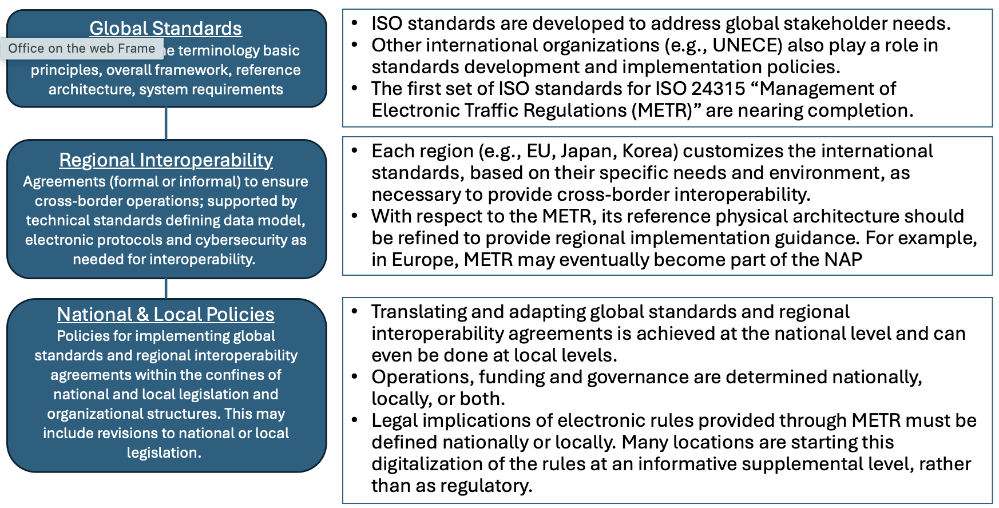

# Regional Environment

METR is specified as a global standard, but each region of the world is expected to adopt their own guidelines and policies for deploying METR. In an ideal "standardized" world, all regions would adopt identical guidelines and policies, but the real world is more complicated. Different regions have different laws, regulations, policies, historical contexts, and preferences that lead to different design decisions. This page describes the regional environment for METR.

Allowing for variations in regional policies and practices results in complications for interoperability. The concept of global regions is intended to provide:

- seamless interoperable travel within a region,
- allowing flexibility in deployment within a region to accommodate local policies and practices, and
- providing a framework for cross-region transitions when travel occurs between regions.

For example, Europe and North America have different laws, regulations, policies, historical contexts, and preferences that lead to different design decisions. The benefits of forcing these two regions to adopt identical guidelines and policies is limited due to the limited number of vehicles that transition between these two regions. By providing a global framework, manufacturers can design vehicles that follow the same operational concepts while being tailored to meet regional interoperability requirements. By allowing each region to define its own interoperability requirements, it should be easier to reach consensus and deploy solutions within each region. As a result, the international METR standards provide for a globally consistent operational concept while still providing for a speedier deployment of the technology than if it was to try to mandate a single solution.

Vehicles that transition between regions can be enhanced to support both regions' interoperability requirements. This potentially includes software updates (e.g., to support a different protocol), hardware modifications (e.g., to support a different radio), and obtaining new security credentials (e.g., to support a different cybersecurity scheme). While not seamless, such a conversion allows a vehicle to cross regional boundaries while still maintaining interoperability within each region.

To enable this, METR adopts a three-layer philosophy. Global standards define the terminology, principles, reference architecture, and system requirements that any deployment can share. A region then agrees how those standards will be used so that travel across the borders inside the region stays interoperable: the data model, the electronic protocols, the cybersecurity scheme, and which features systems are expected to support. National and local authorities apply that regional agreement inside their own legislation, funding, and organizations, including which bodies take which METR roles and whether electronic rules are legally binding or still only informational.

<figure><figcaption>Global standards, regional interoperability, and national and local policies</figcaption></figure>

WIthin this context, a global region is a geographic area in which transport users expect to seamlessly cross jurisdictional boundaries without implementing software or hardware changes. Each locale will need to determine its appropriate global region and determine how it will help develop the regional policies and guidelines. The [regional body](regional-body-perspective.md) is the actor that records that refinement: protocols, directives for which features must be supported, and the architecture choices that jurisdictions inside the region are expected to follow.

Those region-specific policies are refinements of the global standard, not a second copy of the global standard. They say which protocols to use, which features a conforming system must support, and how the reference architecture should be narrowed for that region — for example, whether a national access point collects rules, whether private distributors deliver them, and how a system from outside the region is admitted. The [regional framework](regional-framework.md) and the [regional guidance](ig/regional-guidance.md) describe how a regional body writes that guidance. National and local deployments then assign the roles and adopt the rules inside those constraints.

## Related pages

- [Home](index.md)
- [Regional body perspective](regional-body-perspective.md)
- [Regional framework](regional-framework.md)
- [Regional guidance](ig/regional-guidance.md)
- [System of systems](system-of-systems.md)
