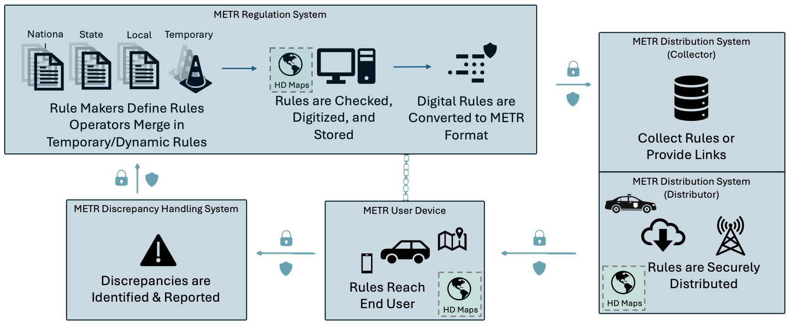

# Guidance for METR Regulation System

!!! note
    ==Audience: Deployer of METR regulation system (e.g., larger jurisdictions)==

    ==Purpose: Guidance for implementation, deployment, maintenance, and operation, including legal and cybersecurity responsibilities==
    
    ==Scope: Guidance on:==
    ==- Prerequisites and policies that need to be established/considered==
    ==- Account management & relationships that may need to be created==
    ==- Resources & capabilities needed==
    ==- Data quality & consistency, certification, certificate management==
    ==- Responsibilities of owner/operator (including any legal responsibilities)==
    ==- Sample project-level architecture, existing systems with similar or related capabilities==

This guide is for the organization that hosts the regulation system, including: state and local transportation agencies, their IT and policy staff, infrastructure owner-operators, and the consultants who support them. The host is responsible for the implementation, operation, and maintenance of the regulation system, including oversight to ensure that the contents of the regulation system are consistent with the regulatory environment and are trustworthy. The regulation system is responsible for the secure ingestion, verification, signing, storage, and maintenance of the official, electronic regulations from all authorized rule makers according to the host's policies. The regulation system is also responsible for providing these rules to other METR systems (primarily distribution systems) in a trustworthy electronic form.

In addition to the issues discussed on this page, stakeholders of the regulation system should also be familiar with the [system management perspective](system-management-perspective.md) for responsibilities that apply to every METR component system.

## Position within the reference architecture

The regulation system is the catalogue. Rule makers define regulations, which are either natively in or are converted into an electronic form, verified, and stored in the regulation system. The electronic regulations are then provided to the distribution systems to deliver to METR user systems. The regulation system also receives discrepancy reports, which are used to correct the electronic regulations or traffic control devices, as needed.

<figure><figcaption>The METR regulation system between rule makers, distribution, and discrepancy handling</figcaption></figure>

## Prerequisites

Deploying a METR regulation system requires meeting several prerequisites to ensure successful implementation. These include all of the prerequisites identified for the **[system management perspective](system-management-perspective.md)**, and the following:

1. Identify the geographic area(s) that the regulation system will serve.
1. Identify the types of regulations that will be supported.
1. Identify the types of vehicles for which regulations will be supported.
1. Identify the certification and certificate management requirements as established by the **[regional body](regional-body-perspective.md)**.
1. Become aware of the legal responsibilities of the owner/operator as established by the **[regional body](regional-body-perspective.md)**.
1. Identify the external systems that the regulation system will need to connect to.
1. Establish agreements with the external systems to exchange the necessary data.
1. Define the deployment architecture.
1. Implement the regulation system in accordance with the **[regional body policies and guidelines](regional-body-perspective.md)**.

## Who may publish, and how far that authority goes

The operator of the regulation system is responsible for setting the policies that determine **who** may define **which** regulations **where** and with **what** authority.

- **Who**: The operator needs to identify the jurisdictional entities to be supported by the regulation system and then identify each rule maker authorized by the entity, and the representatives authorized by the rule maker. Finally, the regulation system needs to identify how it will authenticate the representatives of the rule makers when they publish regulations.
- **Which**: The operator needs to identify the regulation type categories that are supported by the regulation system for defined geographic areas and to what extent permanent, temporary, and emergent regulations are supported.
- **Where**: The operator needs to identify the jurisdictional boundaries of each recognized jurisdictional entity and rule maker. Rule makers are not allowed to define electronic regulations outside their rule maker boundaries and the rule maker boundaries cannot extend beyond the jurisdictional boundaries of its parent jurisdictional entity. The security certificate on the electronic regulation should indicate the jurisdictional boundaries of the rule maker so that the receiving system can validate the legitimacy of the regulation.
- **What**: The operator needs to identify the level of authority granted to each rule maker. This might be the authority to establish regulations that are enforceable by law, the authority to establish regulations that are enforced by the rule maker, or the authority to establish advisory regulations that can be considered in the case of a collision, but are not considered a primary offence.

### Types of entities to be supported

The host of the regulation system needs to establish policies and procedures for recognizing jurisdictional entities and needs to consider the types of entities to be supported by the regulation system. For example, a regulation system can support the following types of rule makers:

- Governmental entities, such as municipality;
- Large government or quasi-governmental campuses, such as a government-owned university or airport;
- Large private campuses, such as a shopping centre, business park, or university; and
- Small entities, such as a single store, car park, or private driveway.

### Rule makers within a jurisdiction

A single jurisdiction often splits the work. A municipality might assign speed limits to the road authority, parking regulations to the city manager, and emergency regulations to its response teams. A large rule maker might also sub-divide its area into smaller areas, which might be managed by sub-rule makers or to allow for better management (e.g., to declare all parking restrictions are available in one area even when they are not available in other areas of the same jurisdiction). The regulation system needs to be aware of these scopes and ensure that one rule maker is prevented from publishing a regulation outside its own authority.

### Supporting multiple rule makers in a regulation system

While each global region and locale will need to establish its own policies, it is envisioned that most regulation systems will support multiple rule makers and that small rule makers are unlikely to establish their own regulation system. Because of this, it is envisioned that most regulation systems will need to support data entry from multiple rule makers, likely from remote locations. To enable this, the host of the regulation system needs to define:

1. a process to become a recognized rule maker;
2. how to manage credentials so that regulations properly indicate their authority;
3. tools or services to all remote rule makers to enter, update, and retire their own regulations;
4. clear expectations for data quality and completeness;
5. a way to transfer responsibility for the regulations if and when a campus is sold or transferred; and
6. a way to handle discrepancies and corrections when they are reported.

Hosts of regulation systems should realize that small rule makers are unlikely to establish their own regulation system; if they are unable to post to the regulation system used by their parent jurisdiction, their regulations likely will not be available within METR. Even if they are able to enter their regulations, smaller campuses are less likely provide and update their electronic regulations. For the trustworthiness of METR, it is important for the regulation system to be able to clearly communicate the limits of electronic regulation availability and quality to end users.

### Onboarding before anyone can publish

Establish a formal process to:

- verify that an applicant is a legitimate authority for the claimed facilities and regulation types
- record the legal basis and the contact points for escalation
- assign organizational identifiers used in audit and provenance metadata
- approve, suspend, or revoke recognition when ownership or responsibility changes

While campus onboarding will likely be lighter than onboarding another public agency, it still has to be deliberate: an unrecognized party must not be able to publish regulations that look authoritative to vehicles and navigation systems.

### Prioritizing regulation categories

The host of the regulation system should work with the rule makers to establish a preferred order of R&R conversion — speed limits, right of way, parking, road works, etc. — so users see a consistent service across the area the system covers.

## Electronic regulation metadata

When distributing electronic regulations, the regulation system must include a range of information about the regulation to ensure that consumers understand the context of the information so that the information is not misused. At a minimum, the distributed electronic regulation should include the following information:

- the core definition of the electronic regulation:
    - the type of the electronic regulation
    - the jurisdictional area of the rule maker that issued the regulation
    - the location(s) associated with the regulation
    - the vehicle types associated with the regulation
    - the conditions under which the regulation is applicable

- metadata about the electronic regulation itself:
    - a timestamp of when the electronic regulation was entered into the regulation system
    - the signature associated with the electronic regulation
    - the organizational identifiers used for the electronic regulation
    - the freshness period for the electronic regulation
    - acceptable supporting data providers to determine if conditions are met

- metadata about the provisioning of the electronic regulation:
    - a timestamp of when the electronic regulation was obtained from the regulation system
    - the freshness period for the electronic regulation

## Verifying the electronic regulation

The regulation system must verify the electronic regulation according to the policies and guidelines established by the **[regional body](regional-body-perspective.md)** and host agency. The verification process can include the following:

- verification that the electronic regulation correctly represents the official regulation
- verification that notifications posted within or near roadways are in place, correctly positioned and clearly visible

## Publishing regulations

Every regulation should follow the same path on the hosted system. The extent of verification should be established by policy, but can vary based on the authority of the rule maker (e.g., government entity vs private campus) and the type of regulation (e.g., regulatory vs advisory).

<figure><figcaption>From recognizing a rule maker through publish, with optional discrepancy handling and discovery</figcaption></figure>

### Published regulations must indicate completeness

The provision of a partial percentage of traffic regulations can lead to confusion and reduced trust, unless systems are informed of the limitations of the data. For example, if a city provides some stop sign locations but not others, users might assume that any location not marked with a stop sign does not have one, creating a safety issue.

METR is designed to follow the existing structures of how R&Rs&mdash;each R&R defined by rule maker is to be captured within the system as a distinct record that can be managed. As a result, there are three possibilities for any location:

1. The location does not have any regulations defined.
2. The location has regulations defined and all of these are available within METR.
3. The location has regulations defined, but not all of them are available within METR.

Given the number of R&Rs that can exist for a jurisdiction, it is likely that some regulations will be published before others. To prevent mis-interpretation of the provided information while improving the benefits of partially entered data, METR modularizes the data so that a rule maker can indicate whether all regulations of a specific type or defined area (which can be a sub-area of a jurisdiction) are available within METR. For example, a rule maker can indicate that all stop signs for a particular subdivision are available within METR. Before a regulation category is published as electronically trustworthy, the rule maker is responsible for ensuring that all regulations of that category in that area are available within METR.

### Regulation Packaging

In most cases, the rule makers will enter the regulations as part of an electronic **[traffic regulation order](tro-what-is-a-tro.md)**, which is an electronic representation of the legal document that establishes one ore more traffic regulations. The rule maker is likely to want to be able to manage each TRO as a unit because the TRO serves as the legal basis for the regulations it contains. However, TROs group regulations from a traffic operations perspective rather than a distribution systems perspective. For example, ==a single TRO for a road works project can contain regulations for lane shifts (including the positioning of traffic cones), speed limits, parking restrictions, and restrictions for different types of vehicles for both directions on multiple roads over multiple phases of a project.== By comparison, a distribution system can choose to limit its scope to only a small portion of these contained regulations. For example, a distribution system could be limited to providing R&Rs for public-area mobile robots (PMRs), in which case, it would not need many of the regulations in the TRO, but it would potentially need some. The exchange agreement between the rule maker and the regulation system should establish whose responsibility it is for filtering out the relevant electronic regulations from the TRO and explaining how the information is intended to remain secure from cybersecurity attacks.

### Who receives the published regulations

The host of the regulation system needs to be aware of the regional policies that govern the distribution of electronic regulations to other systems and to identify each distributor, peer system, and other party that may need to access the electronic regulations.

### Identifying a freshness period for published regulations

Change is inevitable; while many individual regulations are fairly stable, the number of regulations that exist result in constant changes to the full set of regulations for any large jurisdictional area. However, there are time delays between a change being approved and implemented as well as between the time that a change is approved, entered into the regulation system, provided to the distribution system, and distributed to the user. Likewise, complexities in the communication environment result in the user in not necessarily having access to the latest regulation information. Nonetheless, the user needs to know whether the information that they have is still trustworthy, METR calls this the **freshness period**.

The host of the regulation system needs to define a policy that establishes a viable freshness period for distributed electronic regulations. This policy should be communicated to the rule makers and to the distribution systems of the regulation system as a part of the respective agreements. The freshness period impacts how early the rule maker needs to submit a regulation for distribution and how long the consumer system should keep the regulation available for use. Any regulation that is implemented before the time defined by the signing of the electronic regulation plus the freshness period should be treated as an **emergent regulation**. If the jurisdiction claims to publish emergent regulations, it it is responsible for ensuring the emergent regulations are published through the defined emergent regulation distribution process as announced.

### Maintaining a freshness period for stored regulations

The regulation system also needs to determine policies for the freshness period of the electronic regulations and how the regulations are to be maintained. For example, once a permanent regulation is established, it often does not change for years or decades. However, there are several practical limits that need to be considered when storing this information in a regulation system, including:

1. The rule maker can have policies to review the appropriateness of regulations at some interval.
1. The encryption used to protect a signed, electronic regulation will eventually exceed its useful life, i.e., by exceeding its algorithm security lifetime, which decreases with time due to advancements in computer technologies. As such, the regulation system will need to re-encrypt the regulations at some interval and the regulation system needs to establish policies for how to handle the re-encryption.
1. The term permanent regulation is slight misnomer; permanent only means that there is no known expected end time, but any regulation can be changed through the establishment of another TRO. Thus, just because a regulation system has provided a permanent regulation to a distribution system does not mean that it will never change. The agreement between regulation systems and the rule makers and the external systems (e.g., distribution systems) need to explicitly indicate that these regulations can change and are to be considered **stale** after their freshness period expires. The agreement should also indicate the responsibilities and timelines related to keeping this information fresh.

## Optional capabilities

These features are not required for a minimal catalogue. Each one improves trust or access and adds operational work.

### Discrepancy reporting

Discrepancy reports identify conflicts between publicized regulations, such as those between an electronic regulation and a traffic control device, between two electronic regulations, or between two traffic control devices. Linking the regulation system to a discrepancy handling system allows users to report these discrepancies so that the responsible rule maker can investigate the report and take appropriate action.

### Regulation discovery

Regulation discovery is similar to discrepancy reporting, but uses authorized devices and vehicles to report traffic control devices that are identified in the field rather than relying upon users at large. This allows the rule maker to quickly identify and create draft electronic regulations for verification and approval so that the existing regulations can more easily be added to the METR network.

### Independent verification

A check by someone other than the person who entered the regulation raises confidence in accuracy. It also adds cost and another role in the workflow. Regional policies and certification levels should say when that extra check is required.

## Related pages

- [System management perspective](system-management-perspective.md)
- [Jurisdictional management perspective](jurisdictional-management-perspective.md)
- [Rule maker perspective](rule-maker-perspective.md)
- [Regulatory environment](regulatory-environment.md)
- [Key functions](key-functions.md)
