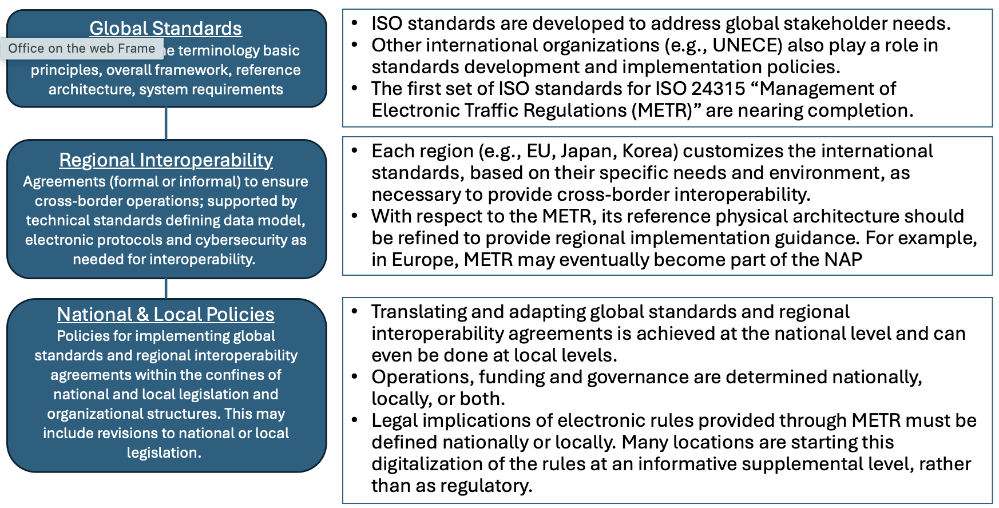

# Tiered Approach

As an international standard, METR has to be flexible enough to support a range of environments. As such, METR is built on the three-tiered model depicted below. This allows for further refinements at the regional (multi-national), national, and local levels to support a connected, interoperable, and safe global transportation ecosystem.

<figure><figcaption>Three-tiered model of METR</figcaption></figure>

Based on this model, the ISO documents capture globally applicable principles and requirements for the trustworthy management and distribution of electronic traffic regulations. The regions are defined as geographic areas within which transport users generally expect to be able to seamlessly travel; these are typically multi-national areas. Each regional body is responsible for refining the global, high-level requirements to promote an interoperable environment within their region. For example, regional bodies will typically want to define policies and interface standards to facilitate data sharing; this might include identifying the cybersecurity scheme, data models, and protocols to be used; which often vary by region. At the national and local level, the details need to be tailored further; for example, identifying how the roles and responsibilities of the various actors defined within the METR standards are to be fulfilled by the various entities within the locality.
