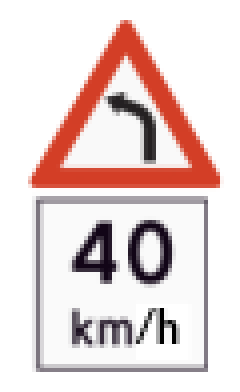
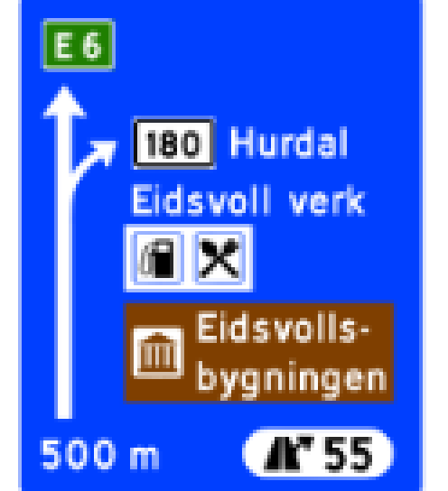
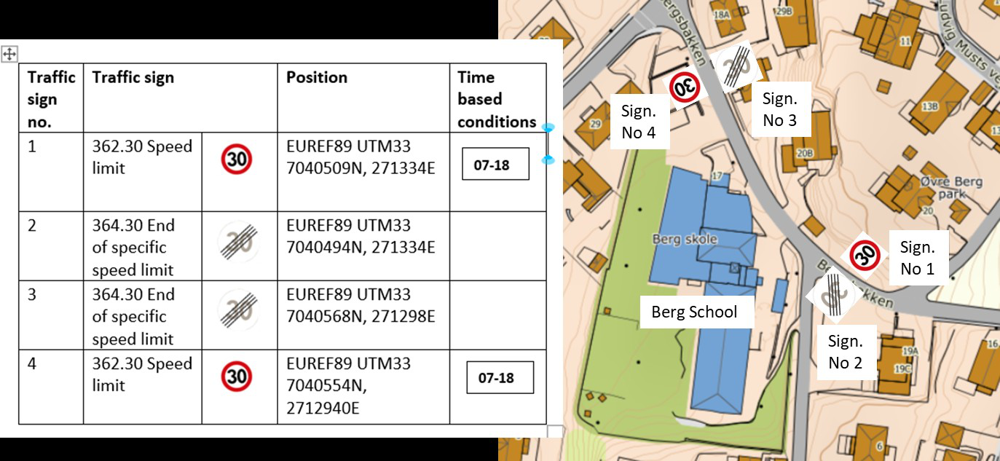
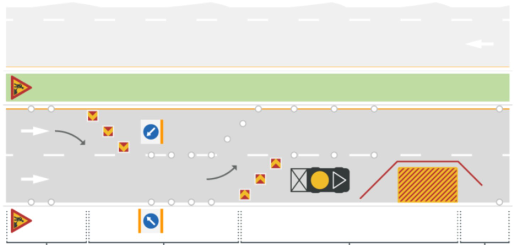

# What is a Traffic Regulation Order?

Most jurisdictions have established legislation that control, guide, and organize road traffic for safety, efficiency, and order. This legislation includes designating responsible authorities (e.g., designating road operators and their responsibilities), the requirements for using the road (e.g., licensing requirements for drivers and vehicles), general behaviour while operating a vehicle (e.g., requirements to drive on a specific side of the road) among other details. Within METR, this legislation is called the **highway code** and is part of the reference environment within which METR operates. The portion of the highway code that defines the general behaviour while operating a vehicle is known as the **rules of the road**.

!!! note
    Some jurisdictions use other names for this legislation (e.g., vehicle code). Small entities (e.g., mom and pop shops) might not have a formal highway code document, relying instead upon the rules of the parent jurisdiction.

The highway code generally identifies the **rule makers** that are authorized to issue various types of **traffic regulation orders** (TROs) under specific conditions. A traffic regulation order is a legally recognized document that officially specifies one or more **traffic regulations** (which can include any combination of mandatory, advisory, or guidance regulations). Rule makers that issue TROs are called **regulators**.

For example, the highway code can designate the road authority as a regulator for who can issue TROs regarding stop signs, speed limits, and other traffic regulations. It can also designate emergency response organizations as regulators who can issue a more limited set of temporary TROs regarding traffic control during an incident.

--8<-- "./images/rr-terms.svg"

<figure><figcaption>Highway code and TROs</figcaption></figure>

!!! note
    This website uses the [\"latest\" terminology](https://isotc204.org/iso24315-vocab/latest/), which varies slightly from ISO 24315-1:2025. For example, in ISO 24315-1:2025, the term \"rule\" was used to reference rules and regulations. On this website,  the term has been refined to only refer to provisions within the rules of the road while a new term (\"rules and regulations\") is used to refer to the combination of the two. Other refinements have been made as well. All of these refinements are expected to be reflected in the next edition of ISO 24315-1.

!!! note
    The distinction between traffic rules and traffic regulations is important to rule makers but largely irrelevant to the end METR user (i.e., they must comply with both) and the content of both can be represented in a single electronic format. Therefore, to simplify the text, the term **electronic regulation** is used to refer to the electronic versions of both R&amp;Rs while the term **electronic TRO** is used to refer to the electronic representation of the containing legal package (i.e., either a portion of a legislative document or a specific regulatory document). For information about prioritising the digitizing of R&R, see ==Prioritisation of electronic regulation (add link)==.

## What a TRO can contain

!!! question
    ==It seems as if a TRO should contain one or more groups of traffic regulations. For example, a TRO might contain a group of traffic regulations for operation of a reversible flow lane in one direction of a road, a second group for operation of the same lane in the other direction, and a third group for a closed reversible flow lane. Likewise, a TRO for road works might contain multiple groups of traffic regulations for different phases of the road works.==

A TRO can include one or more traffic regulations. Each traffic regulation should have:

- a clear mandatory, advisory, or guidance requirement
- a defined location
- conditions that apply
- any permitted exemptions

!!! note
    The legal contents of a TRO can vary by jurisdiction (e.g. region, country, state, city) as directed by overarching legislation within the jurisdiction. This is beyond the scope of this website.

!!! example "Examples of traffic regulations"

    

    

    Regulatory

    Turn left

    

    <figure><figcaption>Mandatory turn-left sign</figcaption></figure>

    

    

    Regulatory

    Left turn forbidden

    

    <figure><figcaption>Left-turn forbidden sign</figcaption></figure>

    

    

    Advisory

    Recommended speed for a sharp curve

    

    <figure><figcaption>Advisory curve warning with a recommended speed</figcaption></figure>

    

    

    Guidance

    Destinations

    

    <figure><figcaption>Guidance sign listing destinations</figcaption></figure>

    

    

The content required to be in a TRO varies by jurisdiction but can frequently include text, drawings, figures, maps with information, pictures etc. METR does not restrict the local legal drafting style, rather it provides a standardized way of representing the intent of the TRO in an interoperable, machine-interpretable form. As such, it supplements the local legal drafting style rather than replacing it.

Traffic rules (i.e., defined in the highway code) are documented in legislation, not in a TRO. However, within METR, electronic TROs can be used to reference either a TRO or a section of the highway code as the source of the R&amp;Rs.

## Example TROs

!!! example "Example TRO: School-zone or residential speed limit"

    A TRO may locate each speed-limit and end-of-limit sign with coordinates and optional time-based conditions (for example, 07:00–18:00 on school days).

    

    <figure><figcaption>Simplified TRO example for a school-zone speed limit</figcaption></figure>

!!! example "Example TRO: Work zone"

    A TRO may specify the traffic control devices needed to protect workers and manage vehicles, pedestrians, and micromobility through the site, including transition plans for the order in which devices are deployed.

    

    <figure><figcaption>Example work-zone layout that a TRO may specify</figcaption></figure>

!!! example "Example TRO: Parking plan"

    A TRO for parking restrictions in part of a city centre or residential area may show required signs and markings for many spaces across multiple streets, each with its own time restrictions.

!!! example "Example TRO: Emergent incident"

    A digitally completed and signed TRO (or activation of a dormant TRO) may temporarily reduce speed and close lanes after a collision, often issued from a traffic management centre or by authorized field personnel.
